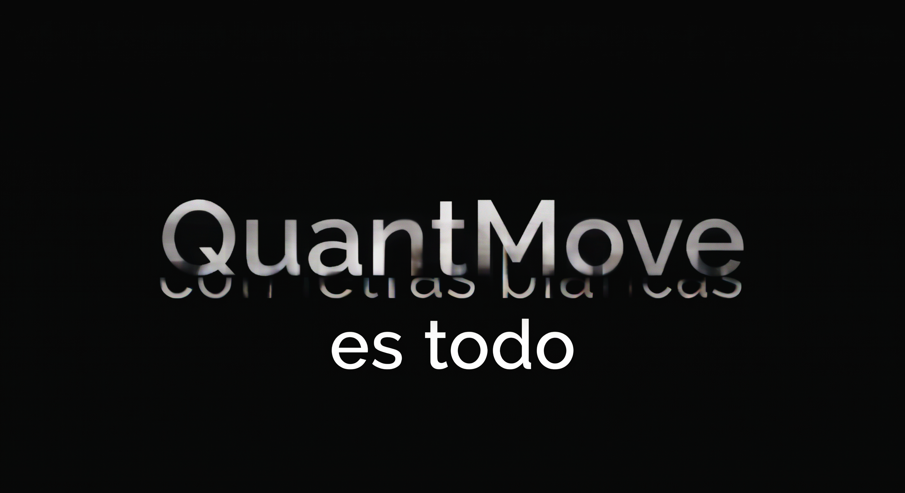

<p align="center">
  
</p>

# QuantMove

Motor cuantitativo de valoración y gestión de riesgos de portafolios.

QuantMove integra herramientas para analizar rendimientos, estimar el riesgo de portafolios y evaluar modelos de riesgo mediante backtesting.

## Funcionalidades

- Validación de datos de precios.
- Descarga de precios ajustados mediante Yahoo Finance.
- Estadísticas de rendimientos y correlación.
- Cálculo de volatilidad del portafolio.
- Estimación histórica de Value at Risk (VaR) y Expected Shortfall (ES).
- Simulación de riesgo mediante Monte Carlo.
- Comparación de estimadores de riesgo.
- Backtesting y pruebas estadísticas de cobertura e independencia.
- Pruebas automatizadas con pytest.
- Demo reproducible con datos sintéticos, sin conexión a internet.

## Requisitos

- Python 3.12 o una versión compatible con `pyproject.toml`.
- Dependencias indicadas en los archivos de requisitos.
- Conexión a internet para descargar datos de mercado.

## Instalación

Desde la raíz del proyecto, ejecuta:

```bash
python -m pip install -e ".[dev]"
```

## Demo reproducible

QuantMove incluye una demostración que utiliza precios sintéticos de dos activos. No descarga datos de mercado y utiliza una semilla fija para facilitar la reproducción de los resultados.

Ejecuta desde la raíz del proyecto:

```bash
python scripts/demo_quantmove.py
```

La demo muestra:

- Número de observaciones de precios y rendimientos.
- Volatilidad del portafolio.
- VaR y Expected Shortfall históricos.
- Comparación con las estimaciones de Monte Carlo.
- Excepciones VaR y diagnósticos de backtesting.

Las métricas de riesgo se presentan como porcentajes de rendimiento por período de observación; no representan cantidades monetarias.

Los datos son sintéticos y los resultados son ilustrativos. Esta demostración permite comprobar el funcionamiento integrado del pipeline, pero no demuestra por sí sola la precisión del modelo con datos financieros reales.

No rechazar una hipótesis estadística en una prueba de backtesting no demuestra que el modelo sea correcto. Los resultados deben interpretarse considerando el tamaño de la muestra y los supuestos de cada prueba.

## Ejecutar las pruebas

Desde la raíz del proyecto:

```bash
python -m pytest -q
```

## Ejemplo con datos de mercado

El siguiente ejemplo descarga precios ajustados de Apple (AAPL) y Microsoft (MSFT) y ejecuta el pipeline de riesgo. Requiere conexión a internet.

```python
from quantmove.data.market_data import download_adjusted_close
from quantmove.portfolio.historical_risk_pipeline import (
    run_historical_risk_pipeline,
)

prices = download_adjusted_close(
    tickers=["AAPL", "MSFT"],
    period="1y",
    interval="1d",
)

weights = {"AAPL": 0.50, "MSFT": 0.50}

result = run_historical_risk_pipeline(
    prices=prices,
    weights=weights,
    confidence=0.95,
    window_size=60,
    significance_level=0.05,
    n_simulations=10_000,
    random_state=42,
)

print(result["historical_var_es"])
print(result["backtest_report"])
```

Los resultados dependen de los datos descargados y de los parámetros utilizados. Los datos de mercado pueden cambiar entre ejecuciones.

## Estructura del proyecto

- `scripts/`: demostraciones y utilidades.
- `src/quantmove/`: código fuente del paquete.
- `tests/`: pruebas automatizadas.
- `pytest.ini`: configuración de pytest.
- `pyproject.toml`: metadatos y configuración del paquete.
- `requirements.txt`: dependencias de ejecución.
- `requirements-dev.txt`: dependencias de desarrollo y pruebas.

## Estado del proyecto

En desarrollo. Las interfaces y la documentación pueden cambiar.

## Aviso

QuantMove es una herramienta de análisis cuantitativo en desarrollo. No constituye asesoramiento financiero ni garantiza resultados futuros.
